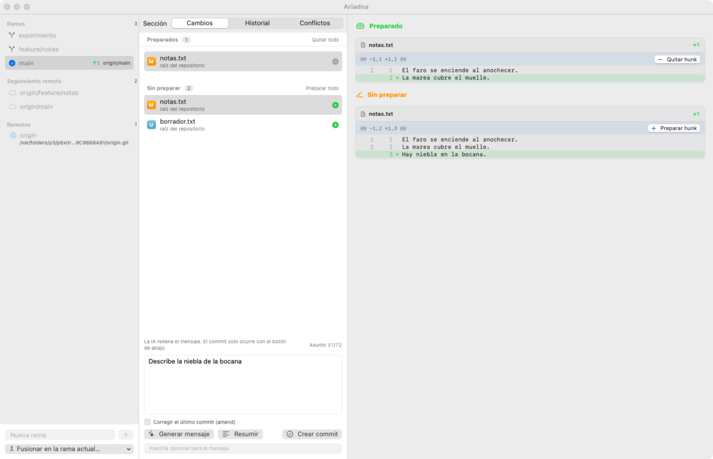
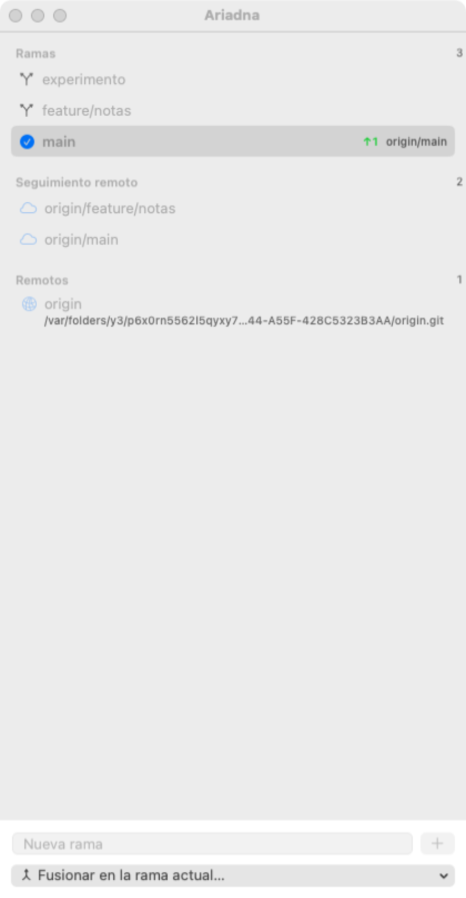
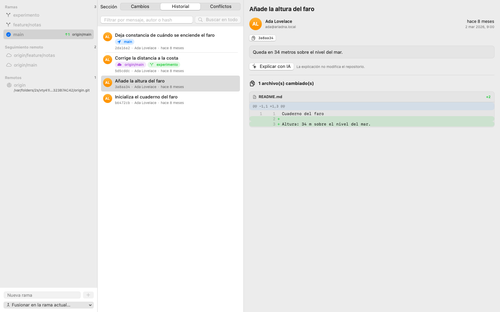
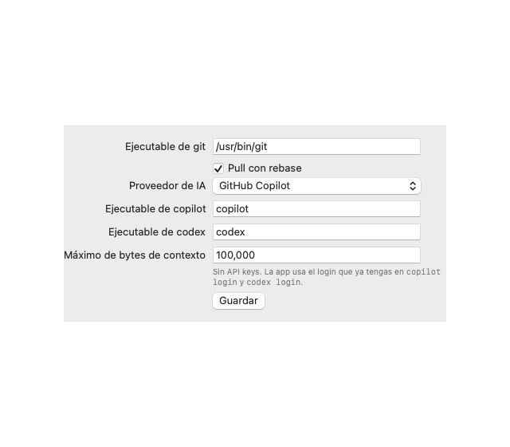
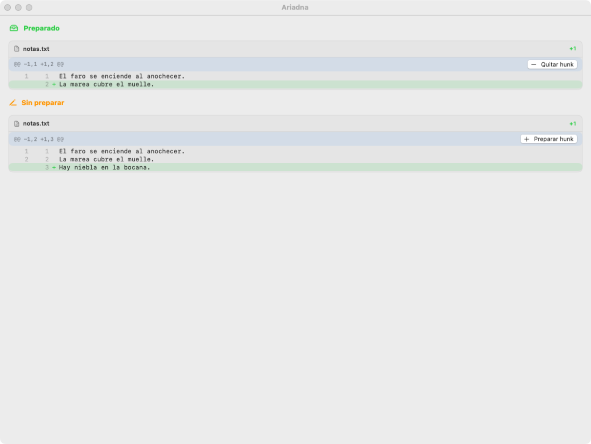
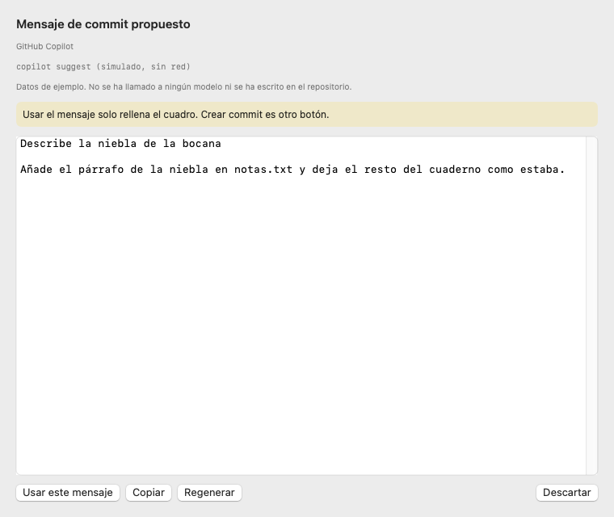

# Ariadna

[](https://github.com/jamartif/ariadna/actions/workflows/ci.yml)
[](https://github.com/jamartif/ariadna/actions/workflows/release.yml)


**Ariadna is a native Git client for macOS**, written in Swift and SwiftUI. Under the hood it uses your system's `git`, so hooks, credentials, configuration and results are the same as in the terminal. What it adds is a clear interface to stage changes by hunk, review history, manage branches and resolve conflicts three-way, with one fixed rule: **nothing that rewrites your repository happens without your confirmation**.

Optionally, behind a build flag, it can ask GitHub Copilot CLI or Codex CLI to draft commit messages, summarize changes, explain commits or propose conflict resolutions. The AI only proposes; you decide.

> The app's interface is currently in Spanish.



## Contents

- [Features](#features)
- [Screenshots](#screenshots)
- [Installation](#installation)
- [Building from source](#building-from-source)
- [Architecture](#architecture)
- [Safety principles](#safety-principles)
- [AI layer (optional)](#ai-layer-optional)
- [Development](#development)
- [Publishing a release](#publishing-a-release)
- [Roadmap](#roadmap)
- [Known limitations](#known-limitations)

## Features

**Repositories**
- Open any folder inside a repo (it walks up to the root), with a clear error if it is not one.
- Recents and favorites, stored in `~/Library/Application Support/Ariadna/recents.json`.

**Changes and commits**
- Status from `git status --porcelain=v2`: staged, unstaged, untracked, ignored and conflicted.
- Stage and unstage **by file or by hunk**, including new files, CRLF, files without a final newline, and paths with spaces and Unicode.
- Discard working-tree changes (always with confirmation).
- Commit with a required message. If HEAD is *detached*, Ariadna warns you and does not create the commit until you confirm.
- **Safe amend**: fixes the last commit (message and/or content) only if it is not on any remote yet, no merge/rebase is in progress and you are on a branch. So it never forces you into a force push.

**History**
- Log with author, date, refs and message body, and the diff of the selected commit.
- Instant filter over what is loaded, and **search across the whole history** by message, author or hash (press Return or *Buscar en todo*).

**Branches and remotes**
- List, create, switch, rename and delete branches. Remote branches (`origin/x`) create the local branch with tracking; if it already exists and does not match, Ariadna asks.
- Fetch, pull (merge or rebase, configurable) and push, with `--set-upstream` the first time.

**Merge and conflicts**
- Merge with fast-forward, no fast-forward or "already up to date".
- Three-way conflict editor (ours / base / theirs), choice by hunk or by whole file, without touching the disk until you confirm.
- Mark as resolved, continue or abort merge, rebase and cherry-pick.

**Robustness**
- Git mutations are queued and run one at a time; reads can overlap. A cancelled refresh never publishes a half-built state.
- Process timeouts and cancellation, and the login shell's `PATH`, so it finds the same `git` as your terminal.
- Git messages are requested in English internally so they are parsed the same way whatever the Mac's language; the interface and errors are shown in Spanish.

## Screenshots

| Branches | History | Settings |
| --- | --- | --- |
|  |  |  |

| Diff by hunk | AI proposal |
| --- | --- |
|  |  |

The screenshots are generated automatically in CI (**Screenshots** workflow, `scripts/render-snapshots.sh`) from a sample repository, so they reflect the real interface on `main`.

## Installation

Requirements: **macOS 15 (Sequoia) or later** and `git` installed (from the Xcode Command Line Tools or Homebrew).

1. Download `Ariadna-X.Y.Z.dmg` (or `.zip`) from the [Releases](https://github.com/jamartif/ariadna/releases) page. The binary is universal (Apple Silicon and Intel).
2. Drag `Ariadna.app` to `/Applications`.
3. The app is ad-hoc signed but **not notarized**. If macOS blocks it the first time, go to **System Settings › Privacy & Security** and click **Open Anyway**, or remove the quarantine flag from Terminal:

```bash
xattr -dr com.apple.quarantine /Applications/Ariadna.app
```

## Building from source

You need macOS 15+ and Xcode 16+ (Swift 6).

```bash
git clone https://github.com/jamartif/ariadna.git
```

```bash
cd ariadna && sh scripts/install-git-hooks.sh && brew install gitleaks
```

```bash
swift test
```

```bash
swift run Ariadna
```

You can also open `Package.swift` in Xcode and run the **Ariadna** scheme.

To build `Ariadna.app`, `.dmg` and `.zip` into `dist/`:

```bash
sh scripts/build-app.sh
```

> `swift test` for the core (`GitCore`) also works on Linux. There, `swift run Ariadna` only reports that the interface is macOS-only and exits with code 64.

## Architecture

It is a Swift Package Manager package with three modules:

```
Sources/
├── GitCore/      UI-free core: models, processes, parsers and Git engine
├── App/          SwiftUI interface ("Ariadna" executable)
└── AriadnaAI/    Copilot CLI and Codex CLI (only with ARIADNA_AI=1)
Tests/
├── GitCoreTests/     Tests against real git repos in temporary folders
└── AriadnaAITests/   AI tests with a process double (no real CLIs)
specs/            Specification, plan and task list
scripts/          Hooks, packaging and screenshots
```

Every action follows the same path:

```
SwiftUI view ─▶ AppModel (@MainActor) ─▶ RepositorySession (actor) ─▶ GitServing ─▶ GitCLIEngine ─▶ ProcessRunner ─▶ git
```

| Piece | Responsibility |
| --- | --- |
| `GitServing` | Protocol with every Git operation. The app and the tests depend on it, not on `Process`. |
| `GitCLIEngine` | Implementation that runs the system `git`. Validates paths and refs, serializes mutations (`GitOperationGate`) and turns failures into `GitError`, with user-facing text in Spanish. |
| `RepositorySession` | State of an open repo (status, branches, remotes, conflicts). Refreshes after every mutation and drops stale refreshes. |
| `PorcelainParser`, `DiffParser`, `ConflictParser` | Parse `status --porcelain=v2 -z`, unified diffs and conflict markers (including diff3). |
| `ProcessRunner` | Subprocesses with timeout, cancellation, stdin and a sanitized environment (no token-like variables). |
| `PathSafety` | Prevents a path or ref from escaping the repo or being read as a git option. |
| `AppModel` | Window state and UI actions; talks to the session with `async/await`. |
| `AmendDraft`, `AmendState` | Amend rules (message prefill, merge warning) and the enable/disable race, testable without the UI. |

The terminal's `git` is used instead of libgit2 on purpose: the behavior is identical to what you already know (hooks, credentials, `includeIf`, LFS…).

*Coming from C#?* A `protocol` is an `interface`, an `actor` is a class whose state is only touched serially, and `@MainActor` is the UI thread.

## Safety principles

- **Explicit confirmation** for everything that can overwrite work: writing a conflict file, discarding changes, aborting an integration, committing with a detached HEAD or switching to a local branch that does not match the remote one. In the core this is enforced with `UserConfirmation.require(confirmed:)`, which has no default value.
- **Never rewrites published history**: amend is refused if the commit is already on a remote branch. There is no force push.
- **Does not touch your configuration**: Ariadna does not write `core.hooksPath` or any other setting in the repos you open.
- **No secrets in child processes**: the environment passed to `git` (and to the AI CLIs) is filtered and leaves out variables whose name contains `TOKEN`, `SECRET`, `PASSWORD` or `API_KEY`.
- **The Ariadna repo is public**: `.gitignore` excludes `.env*`, certificates and keys; the `pre-commit` hook runs `gitleaks protect --staged` and CI runs gitleaks over the whole history.

## AI layer (optional)

The code lives in `Sources/AriadnaAI`, but it is **not part of the default build**. To enable it:

```bash
ARIADNA_AI=1 swift run Ariadna
```

With the flag, the interface gains: *Generar mensaje* (generate message) and *Resumir* (summarize) in the commit bar, *Explicar con IA* (explain with AI) in the history and *Pedir propuesta* (ask for a proposal) in the conflict editor. In Settings you choose the provider and the binary paths.

The app does not ask for API keys: it reuses each CLI's login.

```bash
copilot login
```

```bash
codex login
```

- Copilot runs as `copilot -p … -s`, without shell or write permissions.
- Codex runs as `codex exec --json --sandbox read-only`.
- The context sent has a configurable size cap.
- Every answer arrives as a **proposal** in a separate sheet: you can copy it, use it or discard it. Neither a commit message nor a resolution is applied without your action.

## Development

**Right after cloning**, enable the secrets hook (git does not do it on its own):

```bash
sh scripts/install-git-hooks.sh
```

The script runs `git config --local core.hooksPath .githooks` only in the Ariadna clone.

Common commands:

| Command | What it does |
| --- | --- |
| `swift build` | Builds the core and the app (no AI). |
| `swift test` | `GitCoreTests`, against real git repos in `/tmp`. |
| `ARIADNA_AI=1 swift test` | The above plus `AriadnaAITests`. |
| `swift run Ariadna` | Opens the app (macOS only). |
| `bash scripts/render-snapshots.sh` | Regenerates the screenshots in `docs/screenshots` (macOS only). |
| `sh scripts/build-app.sh` | Packages `.app`, `.dmg` and `.zip` into `dist/`. |

**CI** (`.github/workflows/ci.yml`) runs on every push and PR: gitleaks over the whole history on Ubuntu and, on a `macos-15` runner, `swift build` + `swift test` with and without `ARIADNA_AI=1`.

Design documents: [`specs/spec.md`](specs/spec.md) (what and why), [`specs/plan.md`](specs/plan.md) (how) and [`specs/tasks.md`](specs/tasks.md) (status of each task).

Useful facts:
- Bundle id: `es.javiermartinez.ariadna` (in `Sources/App/Info.plist` and `AriadnaIdentity.bundleIdentifier`).
- App settings and recents: `~/Library/Application Support/Ariadna/`.

## Publishing a release

Every push to `main` and every manual run of the **Release** workflow produce `Ariadna.app`, a `.dmg` and a `.zip` as artifacts. To publish a release with downloads:

```bash
git tag v0.1.0 && git push origin v0.1.0
```

The tag must follow the `vX.Y.Z` format. The workflow, on `macos-15`, builds a universal Release binary (arm64 + x86_64), assembles `Ariadna.app` with the tag's version, signs it ad-hoc (`codesign -s -`) and attaches `Ariadna-X.Y.Z.dmg` and `.zip` to the GitHub Release. Without a `v*` tag, the version is `0.0.0-<short sha>`.

Developer ID signing and notarization are ready in `scripts/build-app.sh`, but they **only run** if all of these repository secrets exist: `APPLE_CERT_P12` (the `.p12` in base64), `APPLE_CERT_PASSWORD`, `APPLE_ID`, `APPLE_TEAM_ID` and `APPLE_APP_PASSWORD`. They never go in the code.

## Roadmap

Pending according to [`specs/tasks.md`](specs/tasks.md):

- [ ] Stage individual lines (not only whole hunks)
- [ ] Commit graph
- [ ] Stash
- [ ] Cherry-pick conflict test
- [ ] Try the AI against the real CLIs; streaming and Copilot SDK / Codex app-server
- [ ] Developer ID signing and notarization
- [ ] English interface

`git clean` of untracked files is left out on purpose: it is irreversible.

## Known limitations

- macOS 15 or later only; the interface does not exist on other platforms.
- The interface is in Spanish only.
- The app is not notarized (see [Installation](#installation)).
- Remote actions use the first configured remote (usually `origin`).
- History and search walk the current branch (HEAD), not all branches.
